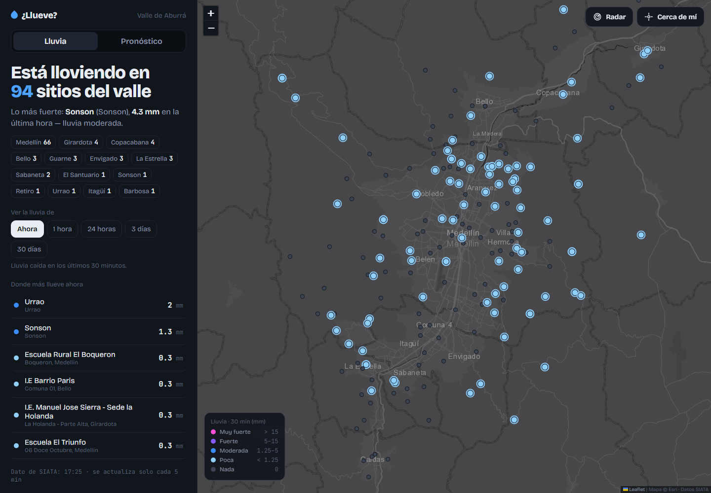

# ¿Llueve?

Una forma directa de entender la lluvia en el Valle de Aburrá. La aplicación reúne estaciones pluviométricas, radar reciente y pronósticos zonales en una interfaz centrada en la pregunta cotidiana: **¿dónde está lloviendo ahora?**



## Qué muestra

- Estado de aproximadamente 225 estaciones de lluvia y acumulados desde 30 minutos hasta 30 días.
- Ranking de lugares con mayor precipitación y detalle por estación.
- Radar animado de las últimas dos horas.
- Pronóstico de SIATA para 13 zonas y de Open-Meteo para Marinilla.
- Geolocalización opcional para encontrar la estación más cercana.

## Arquitectura

El navegador consume un servidor Node.js pequeño. El servidor normaliza las respuestas públicas de SIATA, resuelve sus restricciones de CORS y mantiene una caché corta para evitar solicitudes innecesarias. Marinilla usa la API pública de Open-Meteo y no requiere clave.

```text
Browser → Node.js proxy/cache → SIATA + Open-Meteo
```

## Ejecutar

Requiere Node.js 20 o superior. No usa dependencias externas ni claves de API.

```bash
npm start
```

Abre [http://localhost:5173](http://localhost:5173).

## Fuentes y alcance

Los datos pertenecen a sus proveedores originales. Este proyecto no está afiliado con SIATA, la Alcaldía de Medellín ni Open-Meteo. No debe usarse como único insumo para decisiones de emergencia.

## License

[MIT](LICENSE).

